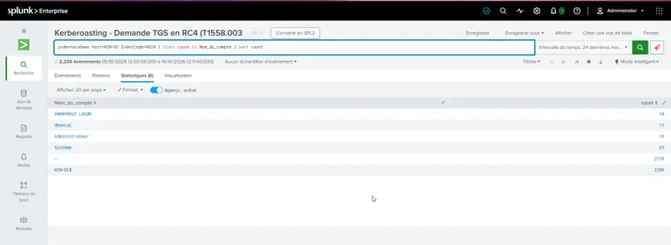
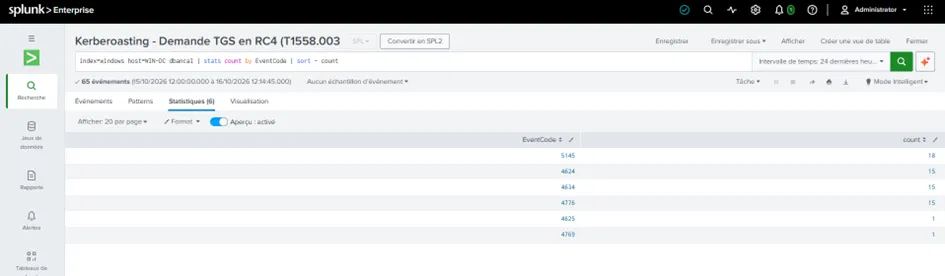
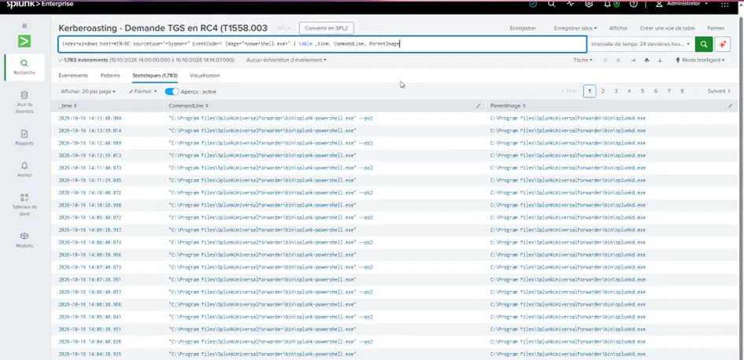
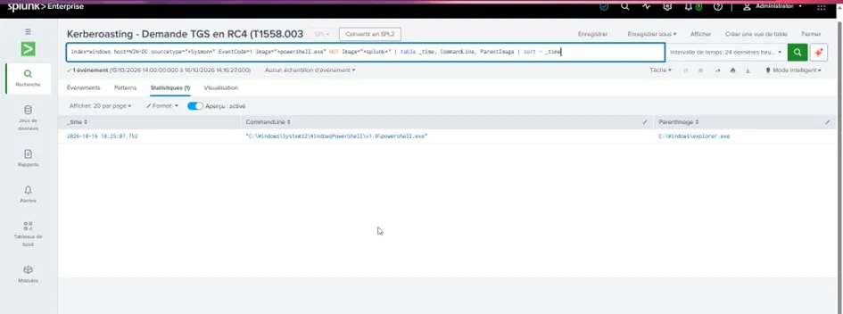
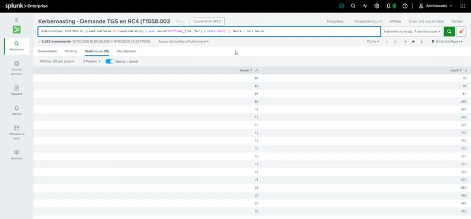
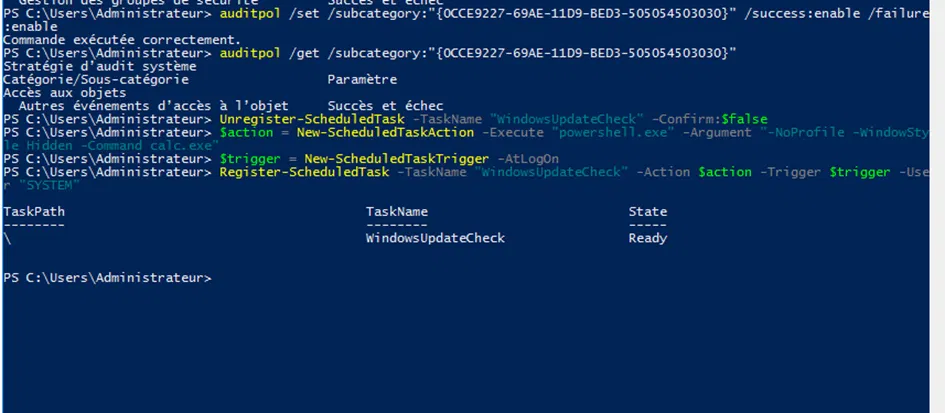
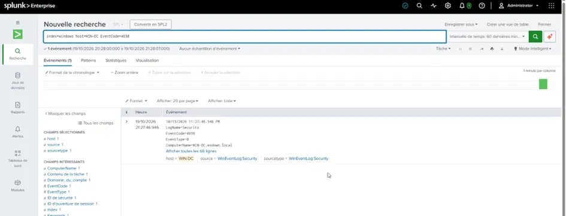

# Threat Hunting sur Active Directory

> Chasse proactive aux menaces — chercher ce que les règles de détection n'ont **pas** attrapé,
> en partant d'hypothèses plutôt que d'alertes.

**Techniques MITRE :** T1087 (Account Discovery) · T1110 (Brute Force) · T1053.005 (Scheduled Task)
**SIEM :** Splunk Enterprise · **Source :** journaux Security + Sysmon (`WIN-DC`)

---

## 1. Résumé

Contrairement à la détection (réagir à une alerte), le **threat hunting** part d'une hypothèse :
*« et si un attaquant avait fait X sans déclencher d'alerte ? »*. On traduit l'hypothèse en
requête, on trie le résultat (normal vs anormal), et chaque trouvaille devient une nouvelle règle
de détection.

Ce projet documente **4 chasses** menées sur un contrôleur de domaine, chacune ayant abouti à une
vraie trouvaille ou à une baseline exploitable.

**Compétences mises en œuvre :** formulation d'hypothèses, analyse de fréquence, baseline
comportementale, distinction signal / bruit légitime, SPL avancé.

---

## 2. Le cycle du hunt

```
Hypothèse  →  Requête SPL  →  Analyse (normal vs anormal)  →  Conclusion
                                                                  │
                              ┌───────────────────────────────────┤
                              ▼                                   ▼
                    Menace trouvée                        Rien d'anormal
                    → nouvelle règle                      → baseline documentée
```

---

## 3. Hunt H1 — Chasse aux comptes rares

**Hypothèse :** un attaquant a peut-être créé ou utilisé un compte qui n'apparaît presque jamais.
Les comptes légitimes génèrent beaucoup d'activité ; un compte compromis ou une backdoor apparaît
**rarement** et de façon isolée.

**Requête :**

```spl
index=windows host=WIN-DC (EventCode=4624 OR EventCode=4625 OR EventCode=4768 OR EventCode=4769 OR EventCode=4776)
| stats count by Nom_du_compte
| sort count
```

> Le `sort count` (croissant) fait remonter les comptes **les moins actifs en premier** — c'est là
> que chasse un hunter.



**Trouvaille :** parmi les comptes système habituels (`WIN-DC$`, `Système` avec des milliers
d'événements), le compte de service **`dbancal`** ressort avec seulement ~15 connexions isolées.
Un compte de service a normalement deux profils : très actif (une appli l'utilise en continu) ou
quasi inactif. Un compte de service avec 15 connexions **interactives isolées** n'est ni l'un ni
l'autre — c'est le profil d'un **compte détourné**.

**Pivot :** en déroulant l'activité de `dbancal`, on reconstruit toute l'attaque (Kerberoasting
4769, accès NTLM 4776, accès aux partages 5145) — **sans avoir connu l'attaque à l'avance**.



---

## 4. Hunt H2 — Chasse aux processus suspects (Sysmon)

**Hypothèse :** un attaquant a peut-être exécuté un outil ou une commande suspecte sur le DC. Un
outil d'attaque apparaît rarement et avec une ligne de commande inhabituelle.

**Requête :**

```spl
index=windows host=WIN-DC sourcetype="*Sysmon*" EventCode=1 Image="*powershell.exe" NOT Image="*splunk*"
| table _time, CommandLine, ParentImage
| sort - _time
```

**La leçon de ce hunt :** la première requête (sans le `NOT Image="*splunk*"`) remontait **1783
exécutions PowerShell** — toutes issues du *Splunk Universal Forwarder* (`splunk-powershell.exe`,
parent `splunkd.exe`). C'est du **bruit légitime**.



Après affinage (`NOT Image="*splunk*"`), il ne restait qu'**un seul** PowerShell réellement
interactif (parent `explorer.exe`) :



> **80 % du threat hunting, c'est écarter le bruit connu pour isoler le signal.** Reconnaître que
> 1783 exécutions = un agent de monitoring, et non une attaque, est exactement le travail d'un
> analyste.

---

## 5. Hunt H3 — Activité à des heures anormales

**Hypothèse :** un attaquant agit souvent en dehors des heures de bureau, quand personne ne
surveille. On cartographie la distribution horaire de l'activité.

**Requête :**

```spl
index=windows host=WIN-DC (EventCode=4624 OR EventCode=4776)
| eval heure=strftime(_time,"%H")
| stats count by heure
| sort heure
```

**Trouvaille (baseline) :** l'activité est concentrée de 8h à 23h, avec une **fenêtre morte de 2h
à 7h** (aucune activité légitime) et une légère activité nocturne 00h-01h.



**La règle de détection qui en découle :**

```spl
index=windows host=WIN-DC (EventCode=4624 OR EventCode=4776)
| eval heure=tonumber(strftime(_time,"%H"))
| where heure>=2 AND heure<=6
```

> Puisque **aucune** activité légitime n'existe entre 2h et 6h, toute authentification sur ce
> créneau devient un signal fort. C'est une détection par **baseline** : on définit le normal pour
> faire ressortir l'anormal.

---

## 6. Hunt H4 — Chasse à la persistance cachée

**Hypothèse :** un attaquant a posé une porte dérobée pour revenir — typiquement une **tâche
planifiée** malveillante (MITRE T1053.005).

**Requête :**

```spl
index=windows host=WIN-DC EventCode=4698
```

**Leçon transverse rencontrée 3 fois dans ce projet : pas de log sans le bon audit.** Au départ,
aucun Event 4698 ne remontait — l'audit « Autres événements d'accès à l'objet » n'était pas activé
sur le DC. Après activation (via le GUID de la sous-catégorie pour contourner la langue du système)
puis recréation d'une tâche de test, l'événement est apparu.





**La tâche détectée** (`WindowsUpdateCheck`) présente tous les marqueurs d'une backdoor :

| Marqueur | Valeur | Interprétation |
|----------|--------|----------------|
| Nom | `WindowsUpdateCheck` | **Masquage** (imite un composant Windows) |
| Exécution | `powershell -WindowStyle Hidden` | Fenêtre cachée = discrétion |
| Déclencheur | `AtLogOn` | Relance à chaque connexion = **persistance** |
| Compte | `SYSTEM` | Privilèges maximum |

> Chacun de ces éléments pris isolément peut être légitime. **Combinés**, ils signent une backdoor.
> Le jugement d'un analyste porte sur le contexte complet, pas sur un attribut isolé.

---

## 7. Les leçons transverses (ce que ce projet m'a appris)

- Le hunt part d'une **hypothèse**, pas d'une alerte.
- **80 % du travail = écarter le bruit légitime** pour isoler le signal.
- Chasser, c'est **itérer** : requête → trop de bruit → affiner → recommencer.
- Chaque trouvaille devient une **règle de détection**.
- Fil rouge rencontré 3 fois : **pas de log sans le bon audit activé en amont**.

---

## 8. Ce que ce projet démontre

- Capacité à **chasser sans IOC de départ** (autonomie d'analyste N2).
- Analyse de **fréquence** et de **baseline comportementale**.
- Distinction rigoureuse **signal / bruit**.
- Transformation systématique d'une trouvaille en **détection** réutilisable.
- SPL avancé : `stats`, `eval`, `bucket`, `strftime`, `dc()`.

