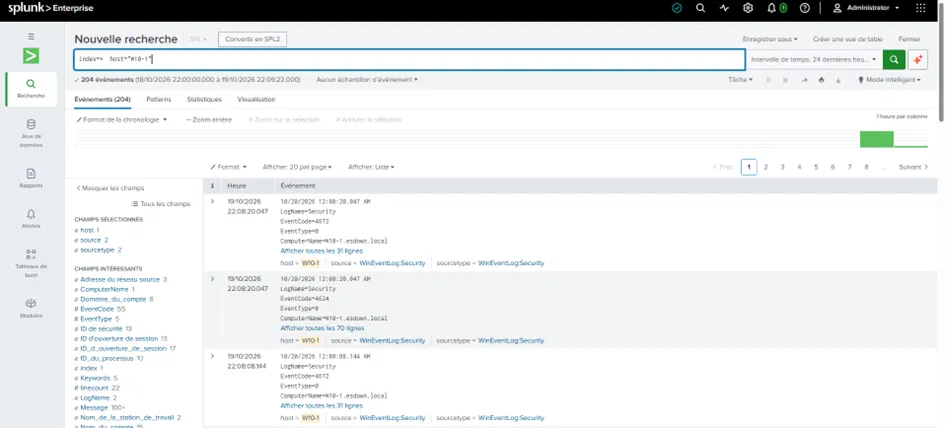
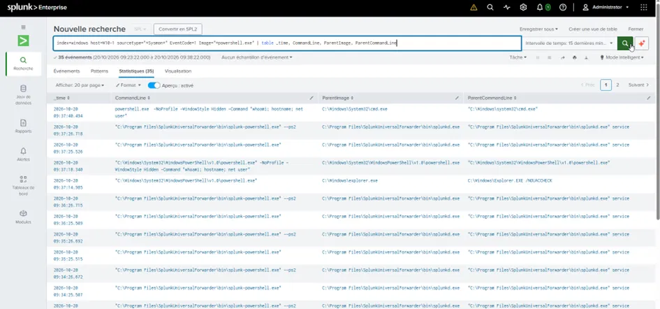
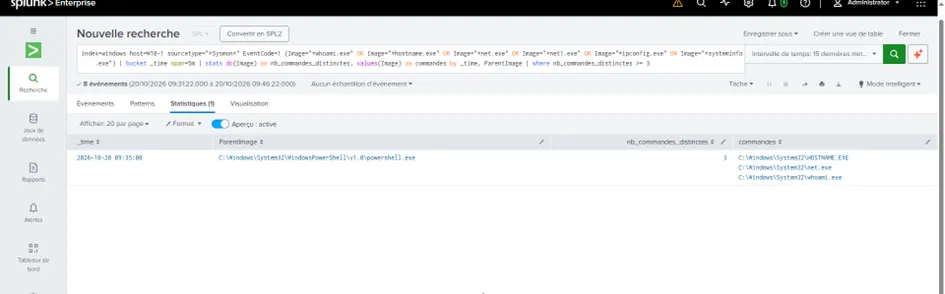
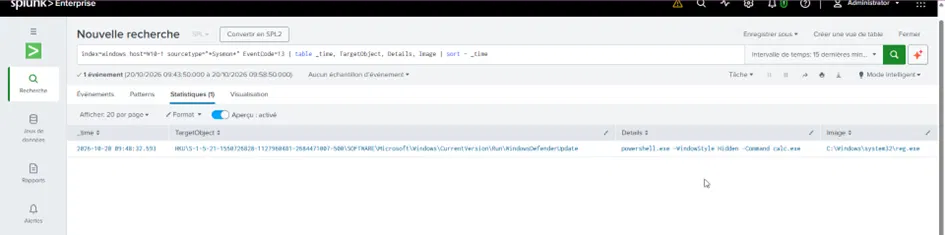

# Détection sur poste client (Endpoint)

> Détecter une compromission de poste utilisateur avec Sysmon — la technique reine de l'EDR :
> l'analyse de la **chaîne parent-enfant**.

**Techniques MITRE :** T1059.001 (PowerShell) · T1033 / T1016 / T1082 (Discovery) · T1547.001 (Registry Run Keys)
**Source :** Sysmon sur le poste client `W10-1`

---

## 1. Résumé

La majorité des attaques entrent par un **poste utilisateur** : un employé ouvre une pièce jointe
piégée, et l'attaquant prend pied avant de se propager. Ce projet simule une compromission
d'endpoint et la détecte via **Sysmon**, en s'appuyant sur le principe central de la détection
EDR : un processus n'est pas suspect en soi, c'est **sa filiation** (qui l'a lancé) et **ses
arguments** qui le trahissent.

**Compétences mises en œuvre :** surveillance endpoint (Sysmon), analyse parent-enfant, détection
par combinaison de signaux faibles, configuration Sysmon.

---

## 2. Mise sous surveillance de l'endpoint

Le poste `W10-1` (Windows 10, joint au domaine) a été équipé de :
- **Sysmon** (journalisation des créations de processus, fichiers, registre)
- **Splunk Universal Forwarder** remontant Security + System + Sysmon vers l'index `windows`

> **Difficulté réelle résolue :** le forwarder n'arrivait pas à lire le journal Sysmon
> (`errorCode=5` — accès refusé). La cause : le service tournait sous un compte sans droit de
> lecture sur ce canal protégé. Solution : faire tourner le service en `LocalSystem`. C'est le
> genre de problème de permissions qu'on rencontre en conditions réelles.



---

## 3. Phase 1-2 — Exécution malveillante (parent-enfant)

Simulation d'une charge malveillante : un PowerShell lancé **depuis cmd**, en mode caché, qui fait
de la reconnaissance locale.

```cmd
powershell.exe -NoProfile -WindowStyle Hidden -Command "whoami; hostname; net user"
```

### La clé de la détection endpoint : la filiation

Un `powershell.exe` seul est banal. Ce qui le rend suspect, c'est **son parent** :

| Parent de PowerShell | Verdict |
|----------------------|---------|
| `explorer.exe` / `services.exe` | Normal (admin, tâche planifiée) |
| `cmd.exe` | À examiner |
| **`winword.exe` / `excel.exe` / `outlook.exe`** | 🚨 **ALARME** — document Office qui lance PowerShell = macro malveillante |
| **`wscript.exe` / `mshta.exe`** | 🚨 **ALARME** — scripts d'attaque |

> **Règle d'or :** une application bureautique ne devrait **jamais** lancer PowerShell.

### La règle de détection

On combine deux signaux faibles (parent suspect + arguments suspects) pour un signal fort, en
écartant le bruit du forwarder Splunk :

```spl
index=windows host=W10-1 sourcetype="*Sysmon*" EventCode=1 Image="*powershell.exe" NOT Image="*splunk*"
(CommandLine="*-WindowStyle Hidden*" OR CommandLine="*-NoProfile*" OR CommandLine="*-enc*" OR CommandLine="*hidden*")
| table _time, CommandLine, ParentImage
```

Les arguments `-WindowStyle Hidden`, `-NoProfile`, `-enc` (commande encodée en Base64) sont
typiques d'un PowerShell malveillant — un administrateur ne les combine quasiment jamais.



---

## 4. Phase 3 — Détection de la reconnaissance locale

Un attaquant qui arrive sur un poste exécute toujours une **rafale de commandes de découverte**
(`whoami`, `hostname`, `ipconfig`, `systeminfo`, `net user`) pour cartographier son environnement
(MITRE T1033 / T1016 / T1082 / T1087).

La détection ne porte pas sur une commande isolée (trop de faux positifs — ces outils sont
légitimes), mais sur le **volume de commandes de découverte distinctes** dans une courte fenêtre :

```spl
index=windows host=W10-1 sourcetype="*Sysmon*" EventCode=1
(Image="*whoami.exe" OR Image="*hostname.exe" OR Image="*net.exe" OR Image="*ipconfig.exe" OR Image="*systeminfo.exe")
| bucket _time span=5m
| stats dc(Image) as nb_commandes_distinctes, values(Image) as commandes by _time, ParentImage
| where nb_commandes_distinctes >= 3
```



> **Détection par agrégation comportementale :** une commande `whoami` est banale. Mais 3-4 outils
> de découverte différents groupés en quelques secondes = signature d'un attaquant qui explore.

---

## 5. Phase 4 — Détection de la persistance (clé Run)

Le mécanisme de persistance n°1 sur un poste Windows : la **clé de registre Run** (MITRE
T1547.001). Tout ce qui y est inscrit se lance automatiquement à chaque connexion.

```cmd
reg add "HKCU\...\CurrentVersion\Run" /v "WindowsDefenderUpdate" /t REG_SZ /d "powershell.exe -WindowStyle Hidden -Command calc.exe" /f
```

Sysmon capture cette écriture dans l'**Event 13** (Registry Value Set) :

```spl
index=windows host=W10-1 sourcetype="*Sysmon*" EventCode=13 TargetObject="*\\CurrentVersion\\Run*"
| table _time, TargetObject, Details, Image
```



L'entrée détectée cumule tous les marqueurs d'une backdoor :
- **Emplacement** `\CurrentVersion\Run\` → auto-démarrage = persistance
- **Nom** `WindowsDefenderUpdate` → masquage (imite un composant Windows)
- **Charge** `powershell -Hidden` → exécution cachée

---

## 6. Leçon transverse : la config Sysmon conditionne la détection

Une config Sysmon minimale ne capture pas tout (création de fichiers, registre…). **La qualité de
la détection endpoint dépend directement de la configuration de Sysmon.** Auditer et améliorer
cette configuration (ex. config SwiftOnSecurity) est une tâche régulière d'un analyste N2 : un
poste peut être « surveillé » sur le papier mais aveugle sur des pans entiers d'activité.

---

## 7. Ce que ce projet démontre

- Surveillance d'un **endpoint** avec Sysmon (le cœur de l'EDR).
- La **chaîne parent-enfant** comme technique reine de détection.
- Combinaison de **signaux faibles** (parent + arguments) en signal fort.
- Détection par **agrégation** (rafale de commandes de découverte).
- Détection de **persistance** via Sysmon registry (Event 13).
- Résolution de problèmes réels (permissions de lecture du journal Sysmon).

